<h1 align="center">LuCI themes for OpenWrt 21.02</h1>

<p align="center">Modern LuCI themes for routers that are still on LuCI 21.02, such as the GL.iNet Flint 2
(GL-MT6000) with GL firmware 4.x: 53 packages, five complete themes ported from newer OpenWrt
and 16 reskins on three layouts.</p>

<p align="center">
  <a href="https://drordvash.github.io/openwrt-21.02-themes/"><b>Gallery</b></a> ·
  <a href="https://drordvash.github.io/openwrt-21.02-themes/playground/"><b>Live playground</b></a> ·
  <a href="https://github.com/DrorDvash/openwrt-21.02-themes/releases/latest"><b>Download</b></a>
</p>

<p align="center"><a href="docs/img/uniwrt21-dark.webp">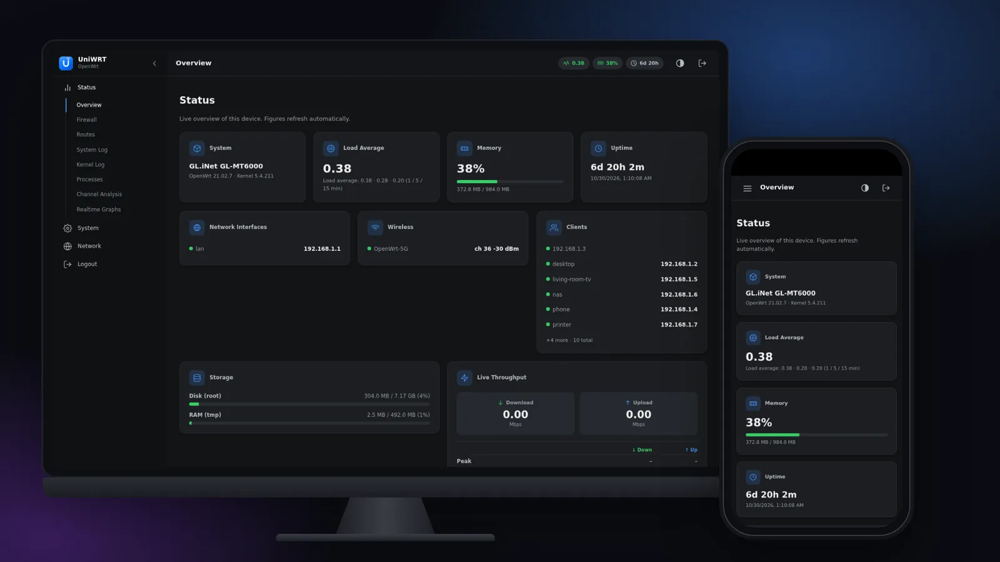</a></p>

> The [gallery](https://drordvash.github.io/openwrt-21.02-themes/) shows every theme bigger, in light and dark, with its login page.

## Why this exists

Many GL.iNet routers run GL firmware 4.x built on **OpenWrt 21.02** and its LuCI web
interface, for example the **Flint 2 (GL-MT6000)**, **Beryl AX (GL-MT3000)**, **Brume 2
(GL-MT2500)** and **Flint (GL-AX1800)**. GL.iNet's
[firmware versions](https://www.gl-inet.com/en-us/pages/firmware-versions) page lists which
OpenWrt each model is built on. Most LuCI themes made in the last few years need
LuCI 23.05 or newer, so on these routers they don't install or they break the pages. Flashing
plain OpenWrt to get them means giving up GL's own firmware.

This repository brings those themes to LuCI 21.02: each one rewritten for 21.02, tested on a
phone and a desktop, and packaged so that installing never changes your current theme and
removing it leaves nothing behind. It is for anyone who has to stay on LuCI 21.02 (GL.iNet 4.x
firmware, or OpenWrt 21.02 itself) and wants a nicer interface.

## Try before you install

The [playground](https://drordvash.github.io/openwrt-21.02-themes/playground/) runs LuCI's own pages in your browser, in any of the themes (a recording
of a test router: nothing is real, nothing is saved, nothing leaves your browser). Pick a theme
with the button at the bottom left, or under System → System → Language and Style; any user name
and password log in.

## Ported themes

Complete themes from newer OpenWrt releases, rewritten for 21.02's Lua templates. Themes with
a dark mode show it in the upper-left half of the picture and light in the lower-right. Click a
picture to enlarge it.

<table>
<tr>
<td width="50%" valign="top"><b>Alpha</b> · 60 KB · <a href="https://drordvash.github.io/openwrt-21.02-themes/playground/alpha21/cgi-bin/luci/">try it</a><br><sub>Port of <a href="https://github.com/derisamedia/luci-theme-alpha">derisamedia/luci-theme-alpha</a> by derisamedia</sub><br><a href="docs/img/alpha21-light.webp">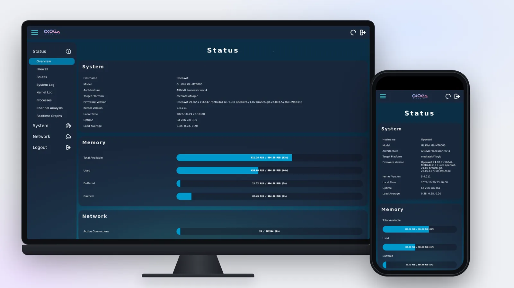</a></td>
<td width="50%" valign="top"><b>Aurora</b> · 70 KB · <a href="https://drordvash.github.io/openwrt-21.02-themes/playground/aurora21/cgi-bin/luci/">try it</a><br><sub>Port of <a href="https://github.com/eamonxg/luci-theme-aurora">eamonxg/luci-theme-aurora</a> by eamonxg</sub><br><a href="docs/img/aurora21-split.webp">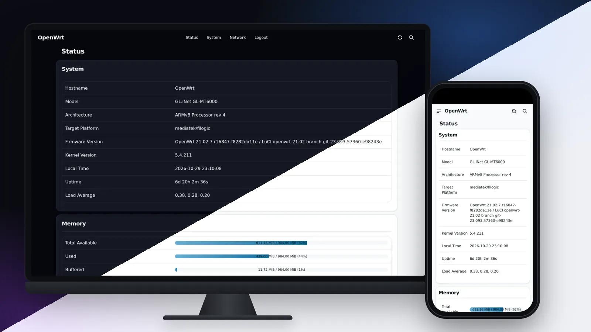</a></td>
</tr>
<tr>
<td width="50%" valign="top"><b>Edge</b> · 149 KB · <a href="https://drordvash.github.io/openwrt-21.02-themes/playground/edge21/cgi-bin/luci/">try it</a><br><sub>Port of <a href="https://github.com/kiddin9/luci-theme-edge">kiddin9/luci-theme-edge</a> by kiddin9 and GaryPang. Dark mode added in this port.</sub><br><a href="docs/img/edge21-split.webp">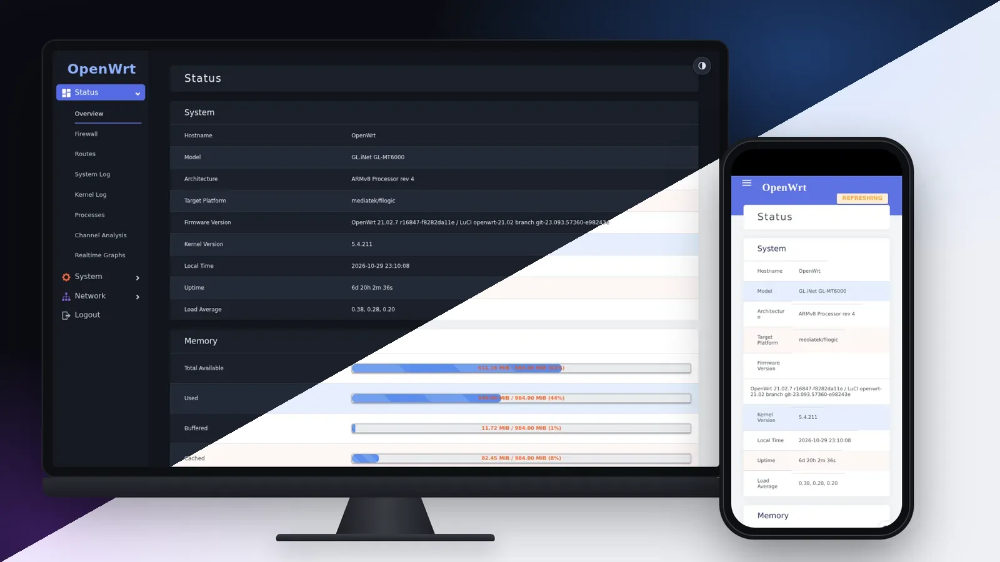</a></td>
<td width="50%" valign="top"><b>NoobWRT</b> · 122 KB · <a href="https://drordvash.github.io/openwrt-21.02-themes/playground/noobwrt21/cgi-bin/luci/">try it</a><br><sub>Port of <a href="https://github.com/nooblk-98/luci-theme-noobwrt">nooblk-98/luci-theme-noobwrt</a> by nooblk-98</sub><br><a href="docs/img/noobwrt21-split.webp">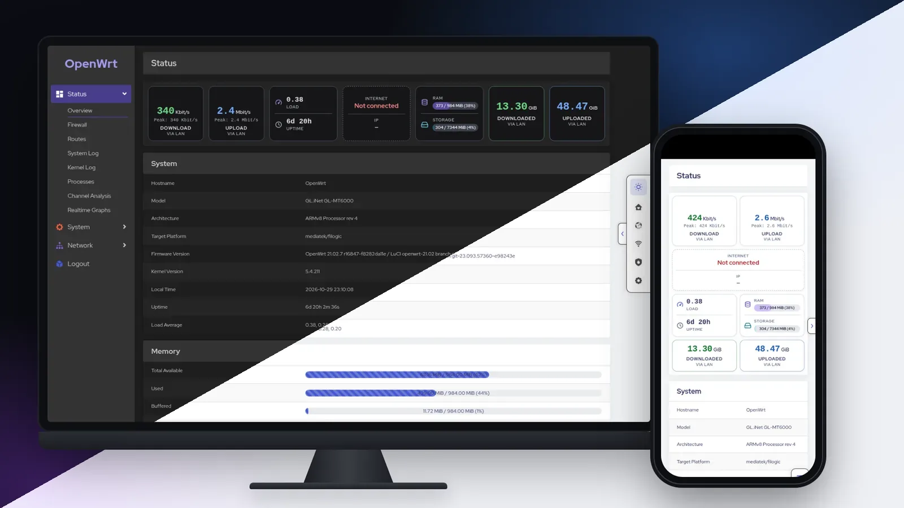</a></td>
</tr>
<tr>
<td width="50%" valign="top"><b>UniWRT</b> · 32 KB · <a href="https://drordvash.github.io/openwrt-21.02-themes/playground/uniwrt21/cgi-bin/luci/">try it</a><br><sub>Port of <a href="https://github.com/ox1d3x3/uniwrt-luci">ox1d3x3/uniwrt-luci</a> by ox1d3x3</sub><br><a href="docs/img/uniwrt21-split.webp">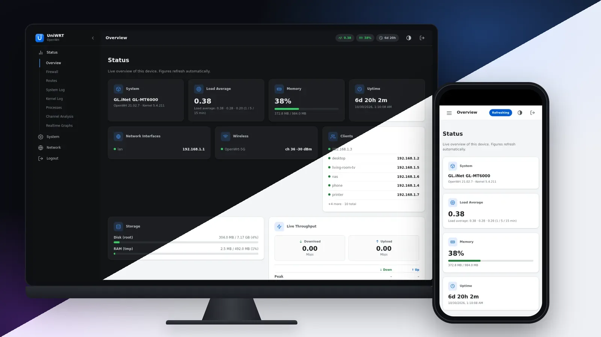</a></td>
</tr>
</table>

## Reskins on three layouts

Sixteen designs by [vistrocity](https://github.com/vistrocity/openwrt-luci-themes), each on three layouts: 21.02's own
[**Bootstrap**](https://github.com/openwrt/luci/tree/openwrt-21.02/themes/luci-theme-bootstrap) (top menu), [**Argon**](https://github.com/jerrykuku/luci-theme-argon) (sidebar, the
layout GL firmware uses) and [**Aurora**](https://github.com/eamonxg/luci-theme-aurora) (top bar with a large menu). Click
a picture to enlarge it, or "try it" to open it in the playground.

<table>
<tr><th></th><th>Bootstrap</th><th>Argon</th><th>Aurora</th></tr>
<tr><td><b>8-bit</b></td><td><a href="docs/img/pixel21-light.webp">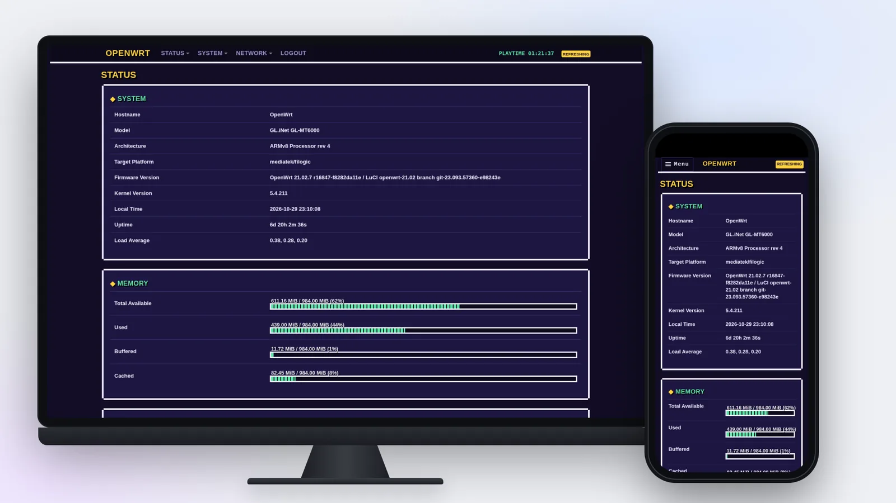</a><br><sub><a href="https://drordvash.github.io/openwrt-21.02-themes/playground/pixel21/cgi-bin/luci/">try it</a> · 25 KB</sub></td><td><a href="docs/img/pixel21-argon-light.webp">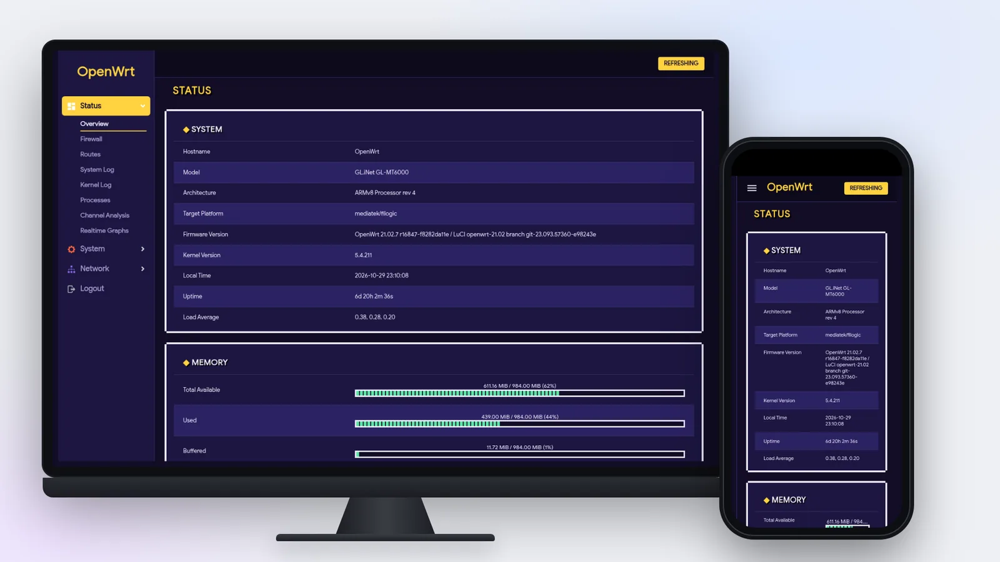</a><br><sub><a href="https://drordvash.github.io/openwrt-21.02-themes/playground/pixel21-argon/cgi-bin/luci/">try it</a> · 136 KB</sub></td><td><a href="docs/img/pixel21-aurora-light.webp">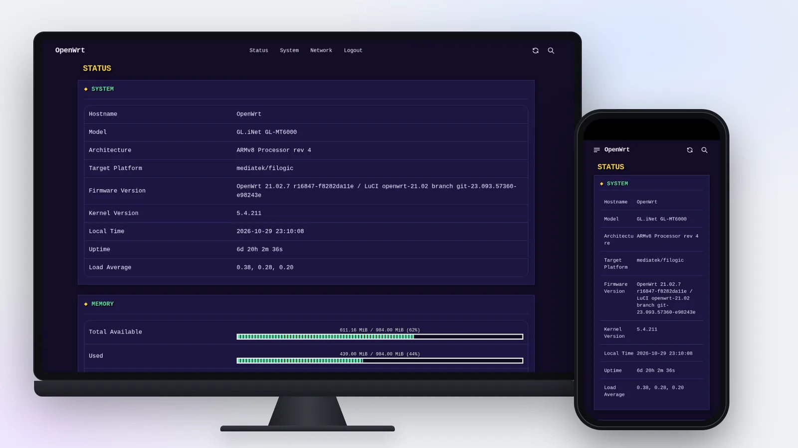</a><br><sub><a href="https://drordvash.github.io/openwrt-21.02-themes/playground/pixel21-aurora/cgi-bin/luci/">try it</a> · 49 KB</sub></td></tr>
<tr><td><b>Aquarium</b></td><td><a href="docs/img/aquarium21-light.webp">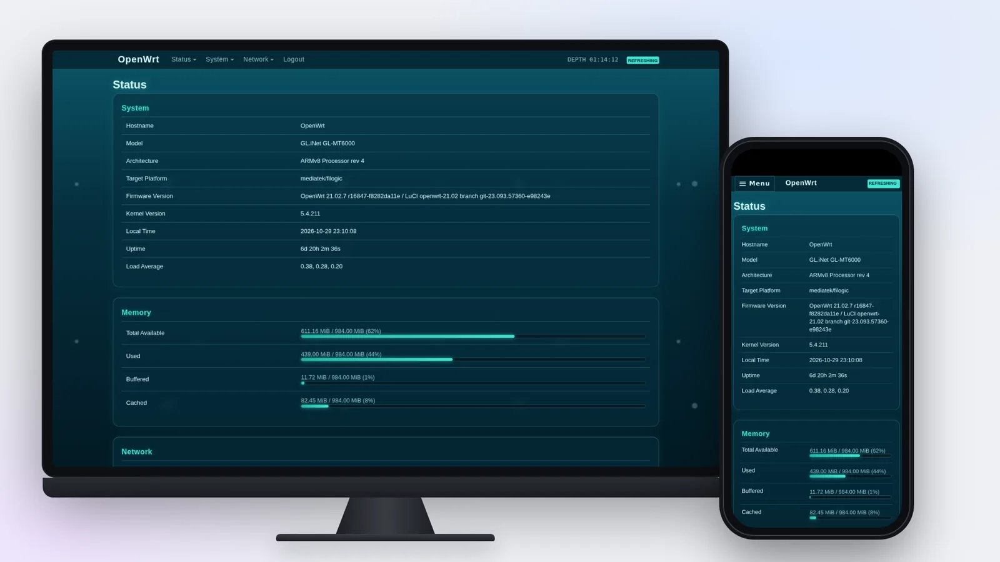</a><br><sub><a href="https://drordvash.github.io/openwrt-21.02-themes/playground/aquarium21/cgi-bin/luci/">try it</a> · 27 KB</sub></td><td><a href="docs/img/aquarium21-argon-light.webp">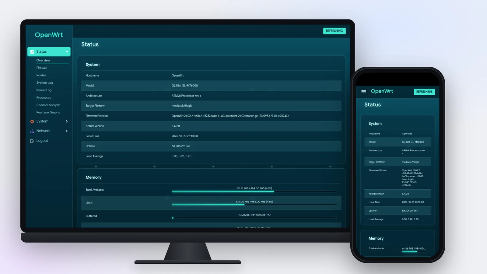</a><br><sub><a href="https://drordvash.github.io/openwrt-21.02-themes/playground/aquarium21-argon/cgi-bin/luci/">try it</a> · 138 KB</sub></td><td><a href="docs/img/aquarium21-aurora-light.webp">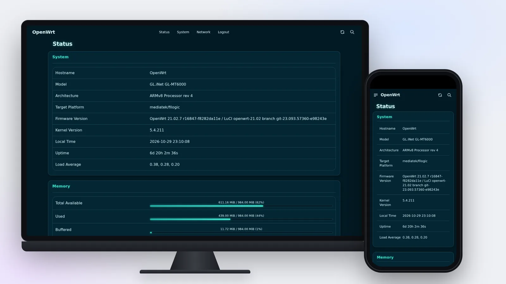</a><br><sub><a href="https://drordvash.github.io/openwrt-21.02-themes/playground/aquarium21-aurora/cgi-bin/luci/">try it</a> · 51 KB</sub></td></tr>
<tr><td><b>Blueprint</b></td><td><a href="docs/img/blueprint21-light.webp">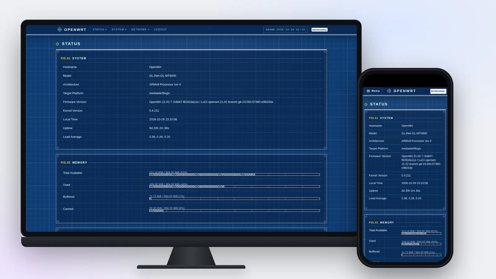</a><br><sub><a href="https://drordvash.github.io/openwrt-21.02-themes/playground/blueprint21/cgi-bin/luci/">try it</a> · 28 KB</sub></td><td><a href="docs/img/blueprint21-argon-light.webp">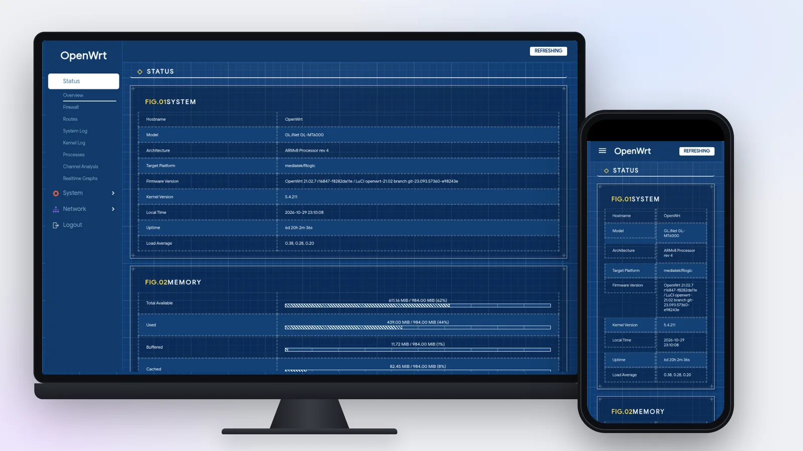</a><br><sub><a href="https://drordvash.github.io/openwrt-21.02-themes/playground/blueprint21-argon/cgi-bin/luci/">try it</a> · 139 KB</sub></td><td><a href="docs/img/blueprint21-aurora-light.webp">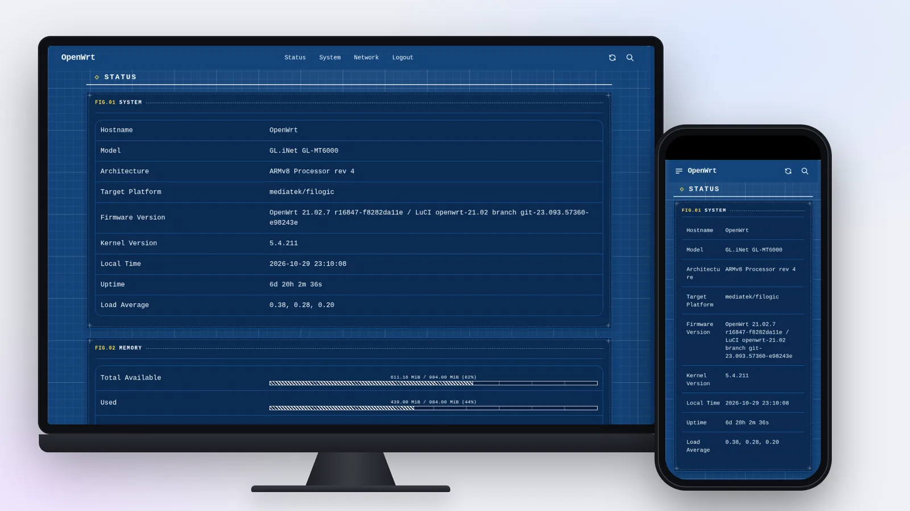</a><br><sub><a href="https://drordvash.github.io/openwrt-21.02-themes/playground/blueprint21-aurora/cgi-bin/luci/">try it</a> · 52 KB</sub></td></tr>
<tr><td><b>Circadian</b></td><td><a href="docs/img/circadian21-light.webp">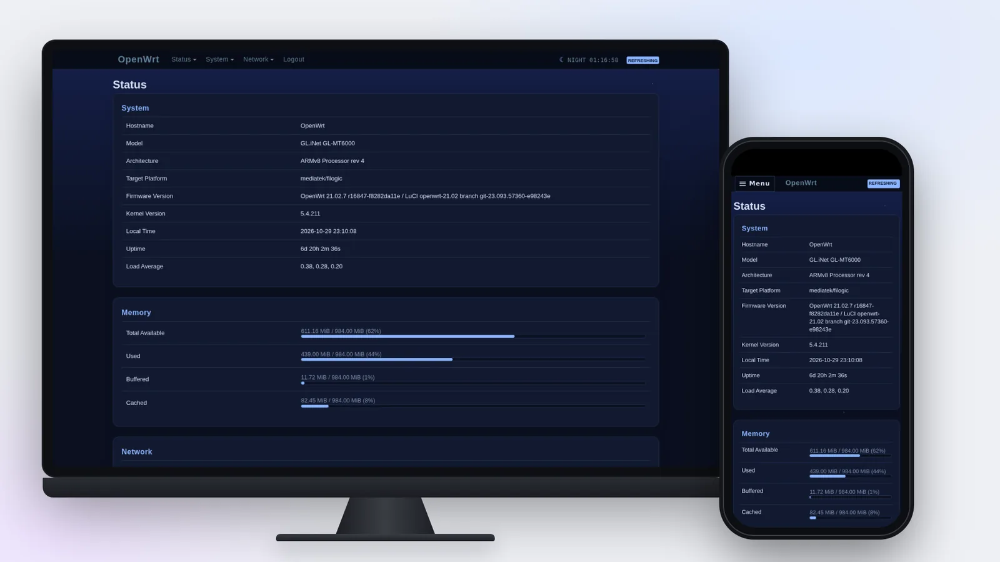</a><br><sub><a href="https://drordvash.github.io/openwrt-21.02-themes/playground/circadian21/cgi-bin/luci/">try it</a> · 28 KB</sub></td><td><a href="docs/img/circadian21-argon-light.webp">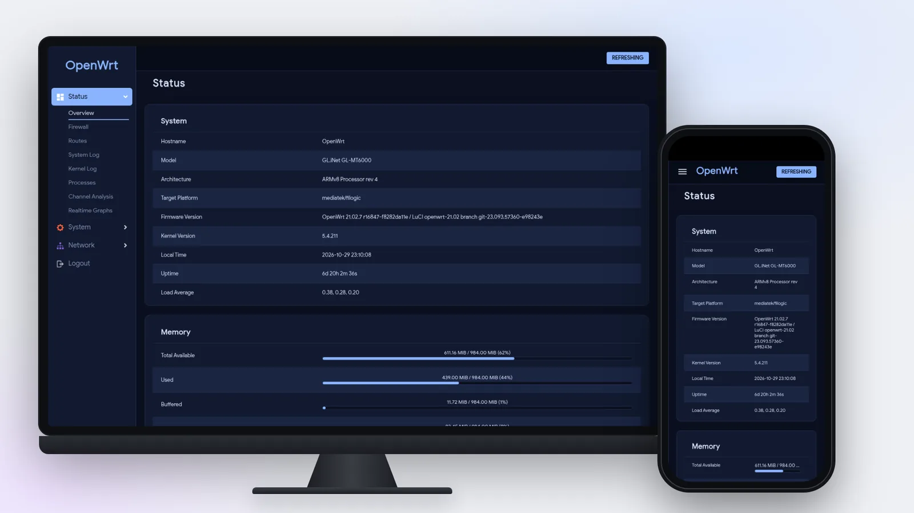</a><br><sub><a href="https://drordvash.github.io/openwrt-21.02-themes/playground/circadian21-argon/cgi-bin/luci/">try it</a> · 137 KB</sub></td><td><a href="docs/img/circadian21-aurora-light.webp">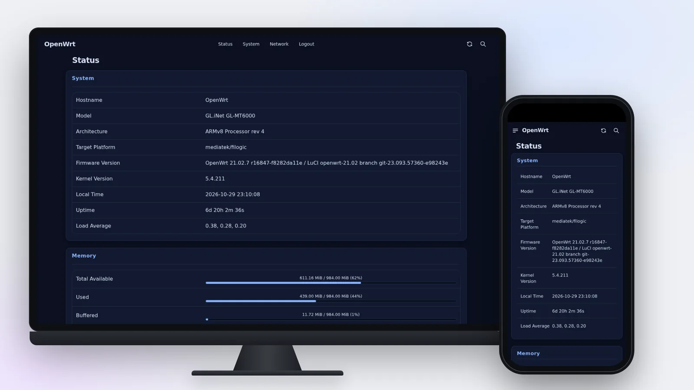</a><br><sub><a href="https://drordvash.github.io/openwrt-21.02-themes/playground/circadian21-aurora/cgi-bin/luci/">try it</a> · 50 KB</sub></td></tr>
<tr><td><b>Glass</b></td><td><a href="docs/img/glass21-light.webp">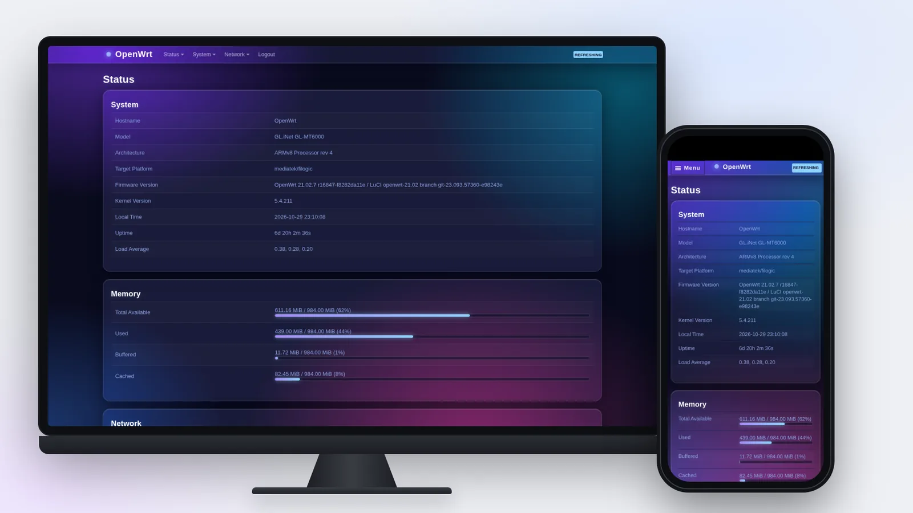</a><br><sub><a href="https://drordvash.github.io/openwrt-21.02-themes/playground/glass21/cgi-bin/luci/">try it</a> · 28 KB</sub></td><td><a href="docs/img/glass21-argon-light.webp">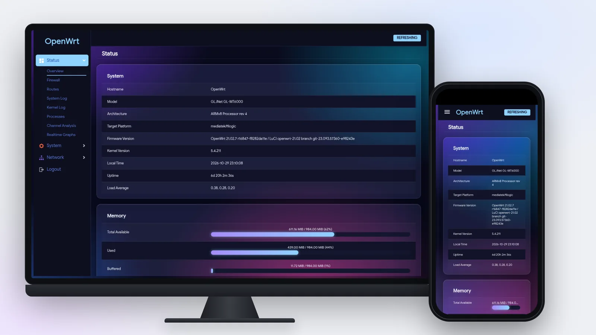</a><br><sub><a href="https://drordvash.github.io/openwrt-21.02-themes/playground/glass21-argon/cgi-bin/luci/">try it</a> · 138 KB</sub></td><td><a href="docs/img/glass21-aurora-light.webp">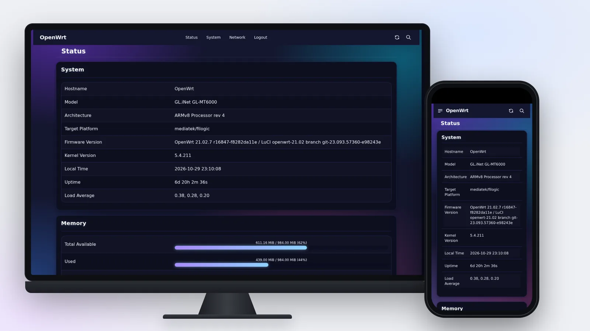</a><br><sub><a href="https://drordvash.github.io/openwrt-21.02-themes/playground/glass21-aurora/cgi-bin/luci/">try it</a> · 52 KB</sub></td></tr>
<tr><td><b>Mission Control</b></td><td><a href="docs/img/mission21-light.webp">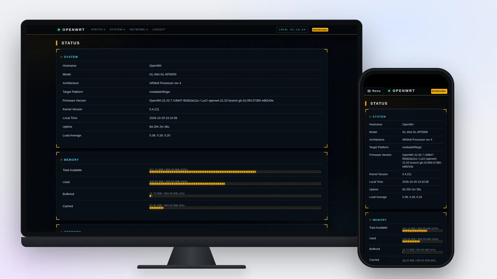</a><br><sub><a href="https://drordvash.github.io/openwrt-21.02-themes/playground/mission21/cgi-bin/luci/">try it</a> · 28 KB</sub></td><td><a href="docs/img/mission21-argon-light.webp">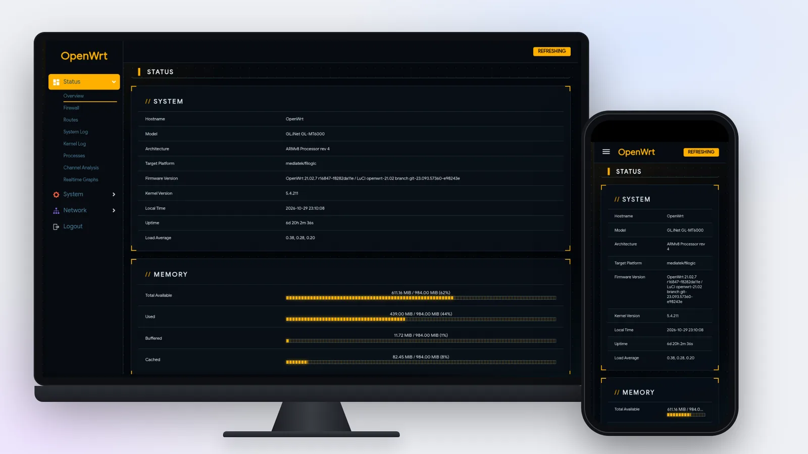</a><br><sub><a href="https://drordvash.github.io/openwrt-21.02-themes/playground/mission21-argon/cgi-bin/luci/">try it</a> · 139 KB</sub></td><td><a href="docs/img/mission21-aurora-light.webp">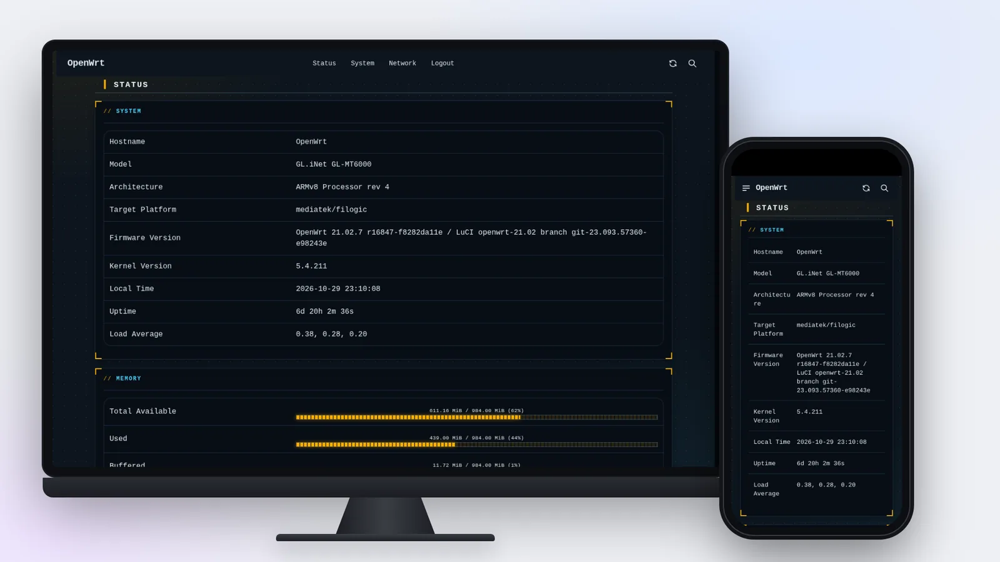</a><br><sub><a href="https://drordvash.github.io/openwrt-21.02-themes/playground/mission21-aurora/cgi-bin/luci/">try it</a> · 52 KB</sub></td></tr>
<tr><td><b>Neobrutalism</b></td><td><a href="docs/img/brutal21-light.webp">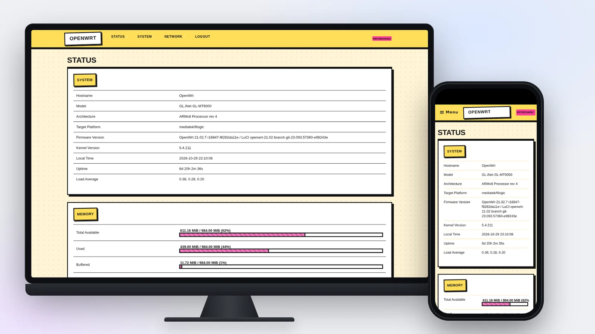</a><br><sub><a href="https://drordvash.github.io/openwrt-21.02-themes/playground/brutal21/cgi-bin/luci/">try it</a> · 25 KB</sub></td><td><a href="docs/img/brutal21-argon-light.webp">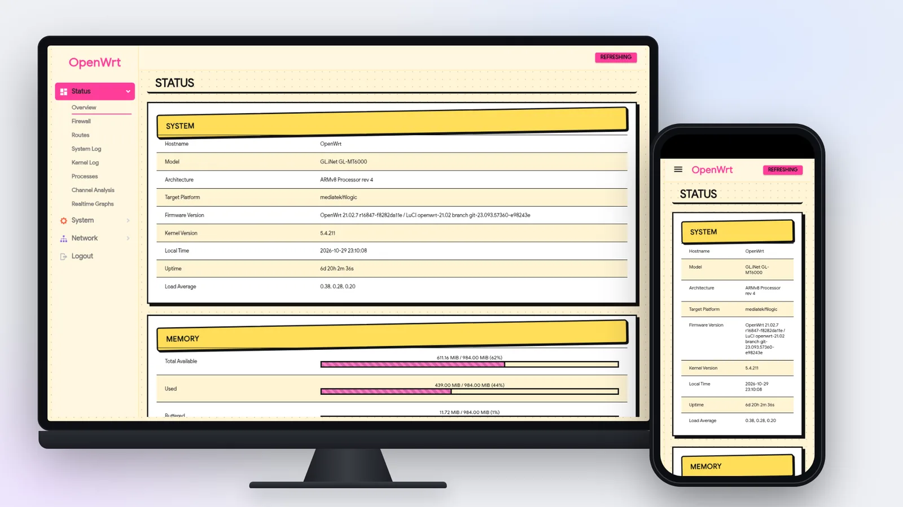</a><br><sub><a href="https://drordvash.github.io/openwrt-21.02-themes/playground/brutal21-argon/cgi-bin/luci/">try it</a> · 136 KB</sub></td><td><a href="docs/img/brutal21-aurora-light.webp">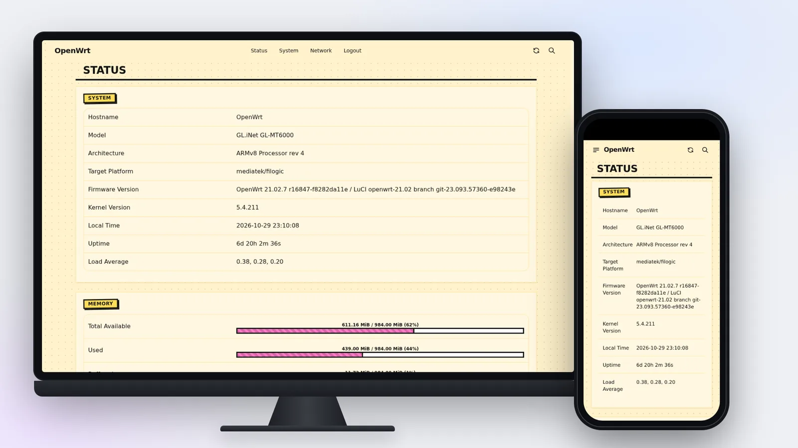</a><br><sub><a href="https://drordvash.github.io/openwrt-21.02-themes/playground/brutal21-aurora/cgi-bin/luci/">try it</a> · 49 KB</sub></td></tr>
<tr><td><b>Obsidian</b></td><td><a href="docs/img/obsidian21-light.webp">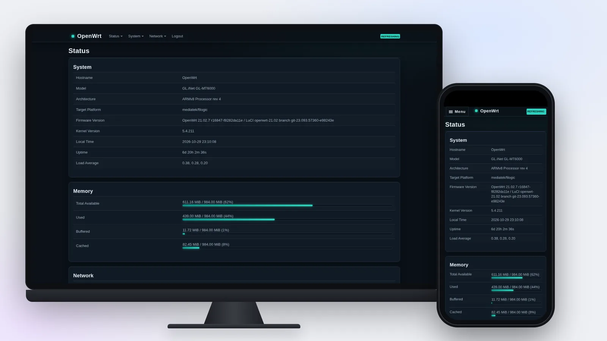</a><br><sub><a href="https://drordvash.github.io/openwrt-21.02-themes/playground/obsidian21/cgi-bin/luci/">try it</a> · 27 KB</sub></td><td><a href="docs/img/obsidian21-argon-light.webp">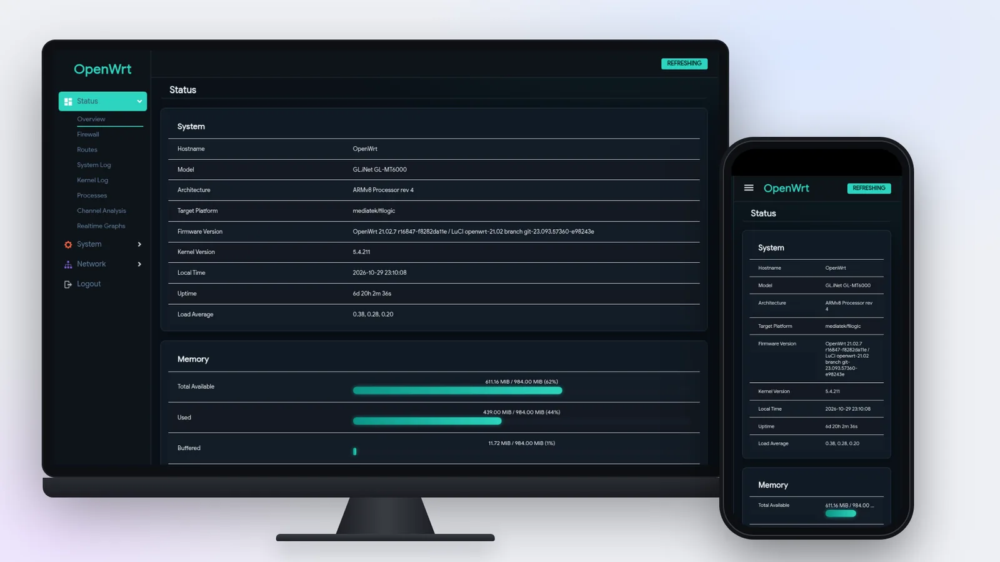</a><br><sub><a href="https://drordvash.github.io/openwrt-21.02-themes/playground/obsidian21-argon/cgi-bin/luci/">try it</a> · 138 KB</sub></td><td><a href="docs/img/obsidian21-aurora-light.webp">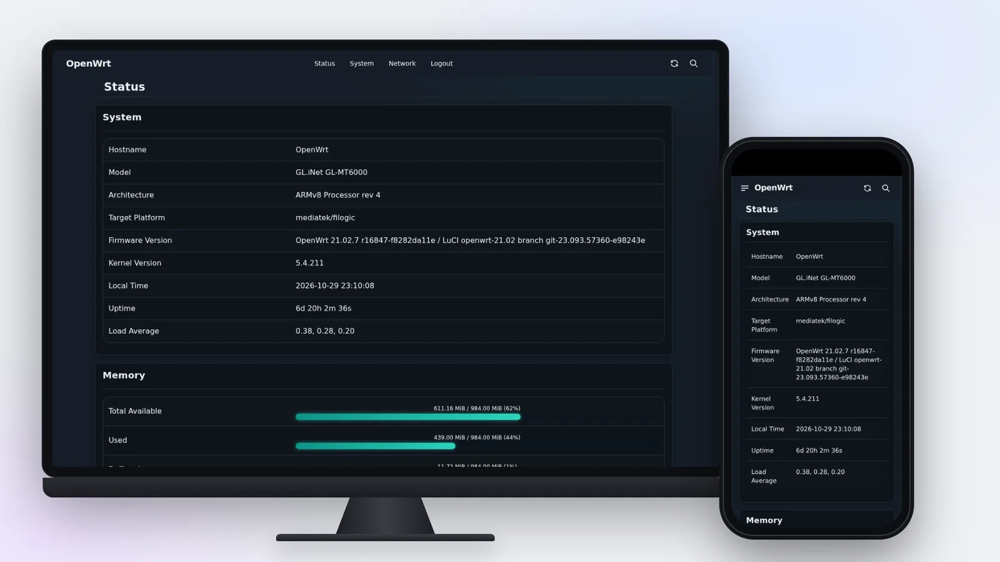</a><br><sub><a href="https://drordvash.github.io/openwrt-21.02-themes/playground/obsidian21-aurora/cgi-bin/luci/">try it</a> · 51 KB</sub></td></tr>
<tr><td><b>Paper</b></td><td><a href="docs/img/paper21-light.webp">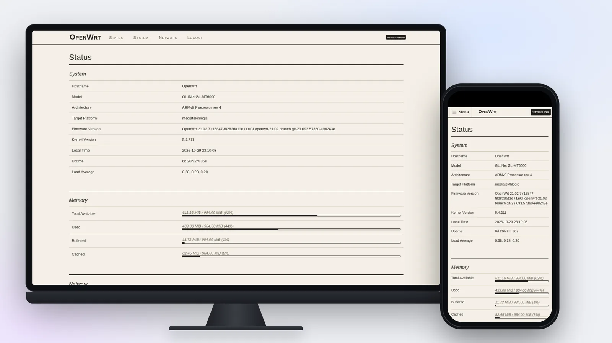</a><br><sub><a href="https://drordvash.github.io/openwrt-21.02-themes/playground/paper21/cgi-bin/luci/">try it</a> · 25 KB</sub></td><td><a href="docs/img/paper21-argon-light.webp">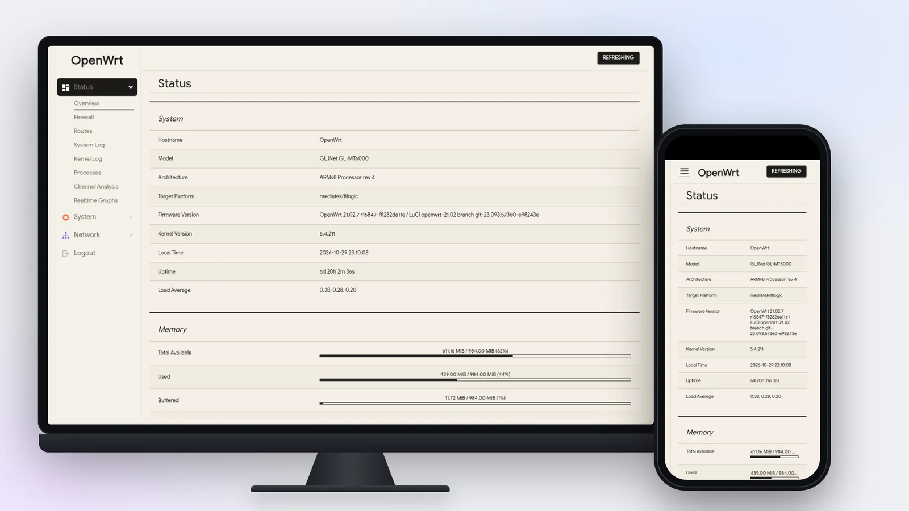</a><br><sub><a href="https://drordvash.github.io/openwrt-21.02-themes/playground/paper21-argon/cgi-bin/luci/">try it</a> · 136 KB</sub></td><td><a href="docs/img/paper21-aurora-light.webp">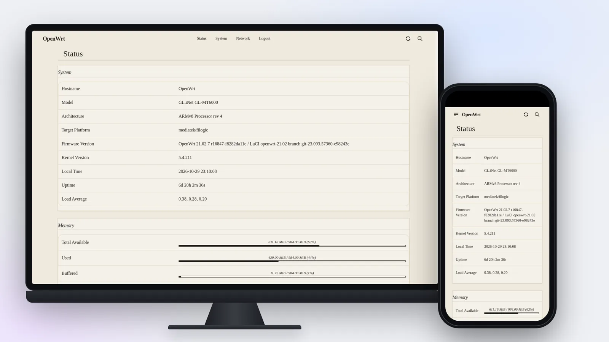</a><br><sub><a href="https://drordvash.github.io/openwrt-21.02-themes/playground/paper21-aurora/cgi-bin/luci/">try it</a> · 49 KB</sub></td></tr>
<tr><td><b>Rack</b></td><td><a href="docs/img/rack21-light.webp">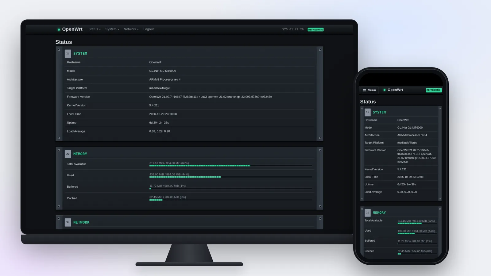</a><br><sub><a href="https://drordvash.github.io/openwrt-21.02-themes/playground/rack21/cgi-bin/luci/">try it</a> · 26 KB</sub></td><td><a href="docs/img/rack21-argon-light.webp">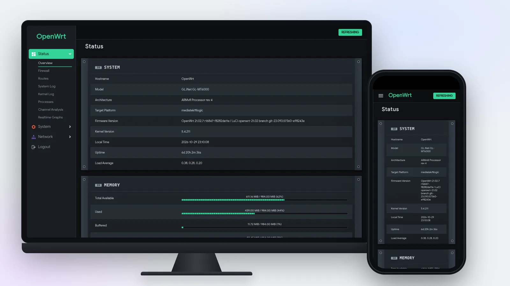</a><br><sub><a href="https://drordvash.github.io/openwrt-21.02-themes/playground/rack21-argon/cgi-bin/luci/">try it</a> · 136 KB</sub></td><td><a href="docs/img/rack21-aurora-light.webp">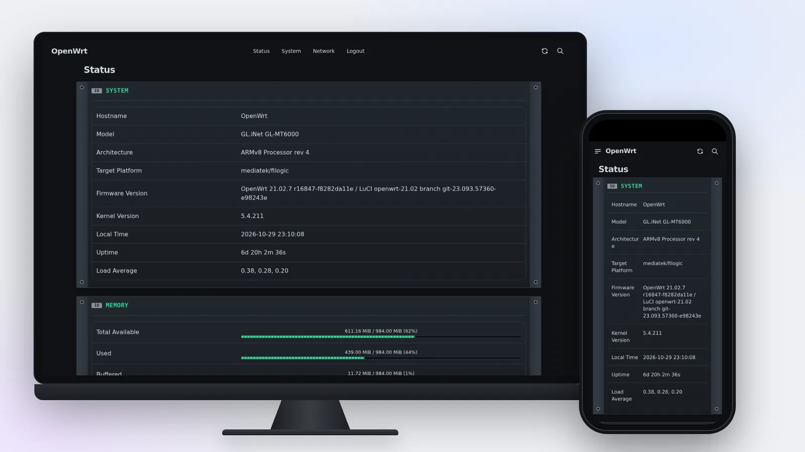</a><br><sub><a href="https://drordvash.github.io/openwrt-21.02-themes/playground/rack21-aurora/cgi-bin/luci/">try it</a> · 49 KB</sub></td></tr>
<tr><td><b>Retro</b></td><td><a href="docs/img/retro21-light.webp">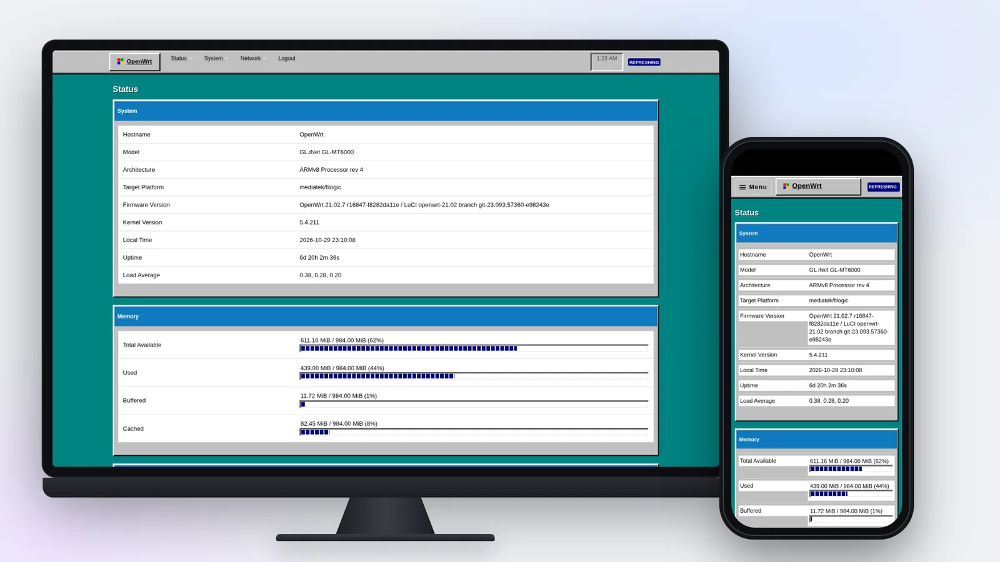</a><br><sub><a href="https://drordvash.github.io/openwrt-21.02-themes/playground/retro21/cgi-bin/luci/">try it</a> · 25 KB</sub></td><td><a href="docs/img/retro21-argon-light.webp">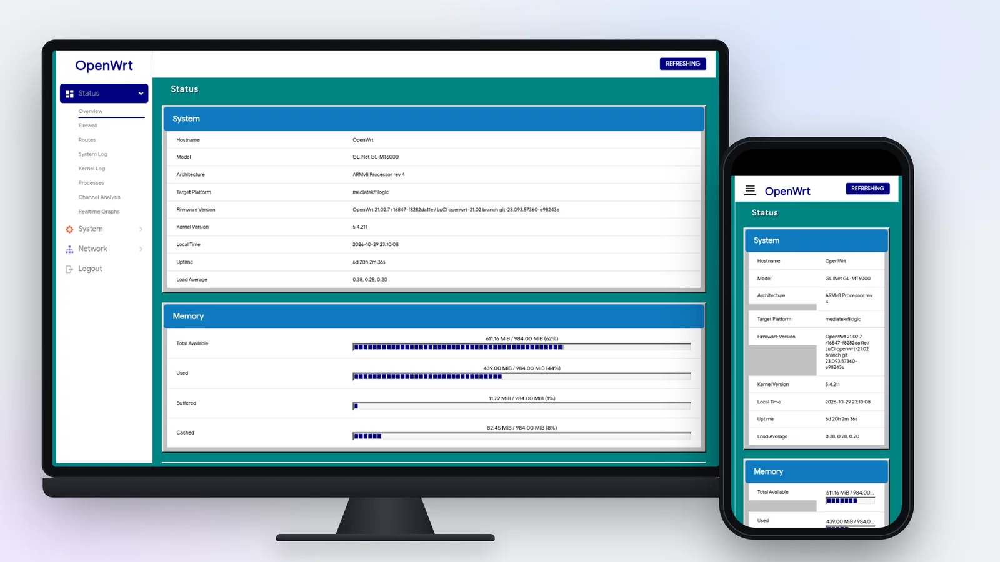</a><br><sub><a href="https://drordvash.github.io/openwrt-21.02-themes/playground/retro21-argon/cgi-bin/luci/">try it</a> · 136 KB</sub></td><td><a href="docs/img/retro21-aurora-light.webp">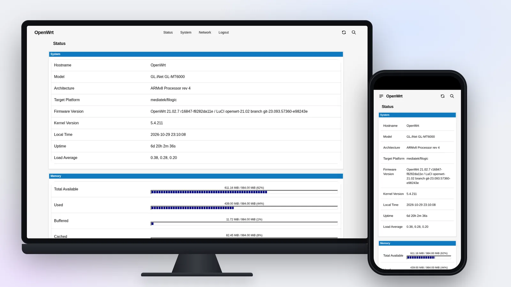</a><br><sub><a href="https://drordvash.github.io/openwrt-21.02-themes/playground/retro21-aurora/cgi-bin/luci/">try it</a> · 49 KB</sub></td></tr>
<tr><td><b>Sumi-e</b></td><td><a href="docs/img/sumie21-light.webp">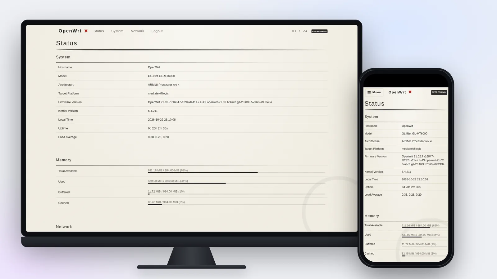</a><br><sub><a href="https://drordvash.github.io/openwrt-21.02-themes/playground/sumie21/cgi-bin/luci/">try it</a> · 27 KB</sub></td><td><a href="docs/img/sumie21-argon-light.webp">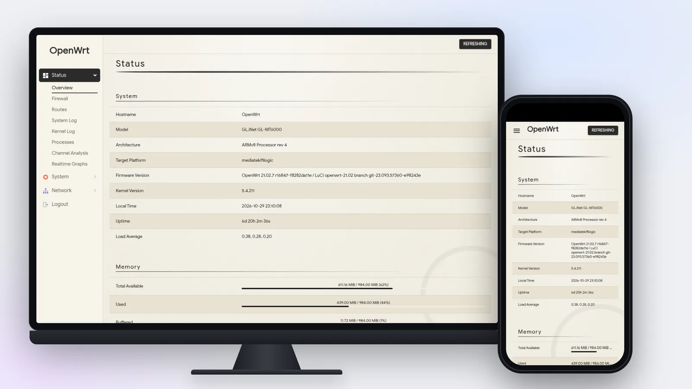</a><br><sub><a href="https://drordvash.github.io/openwrt-21.02-themes/playground/sumie21-argon/cgi-bin/luci/">try it</a> · 138 KB</sub></td><td><a href="docs/img/sumie21-aurora-light.webp">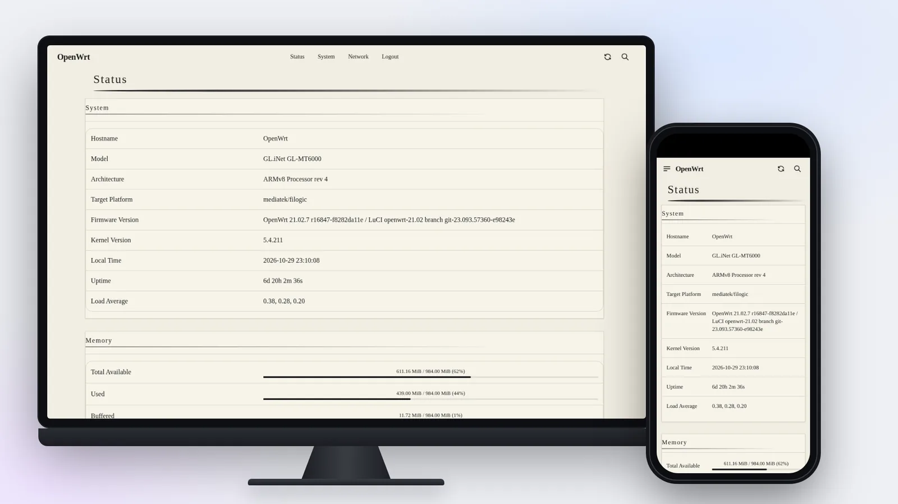</a><br><sub><a href="https://drordvash.github.io/openwrt-21.02-themes/playground/sumie21-aurora/cgi-bin/luci/">try it</a> · 51 KB</sub></td></tr>
<tr><td><b>Synthwave</b></td><td><a href="docs/img/synthwave21-light.webp">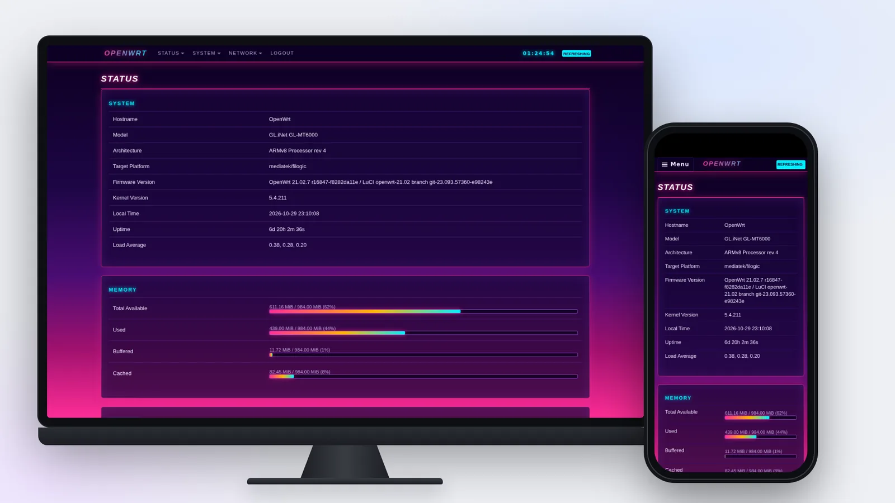</a><br><sub><a href="https://drordvash.github.io/openwrt-21.02-themes/playground/synthwave21/cgi-bin/luci/">try it</a> · 28 KB</sub></td><td><a href="docs/img/synthwave21-argon-light.webp">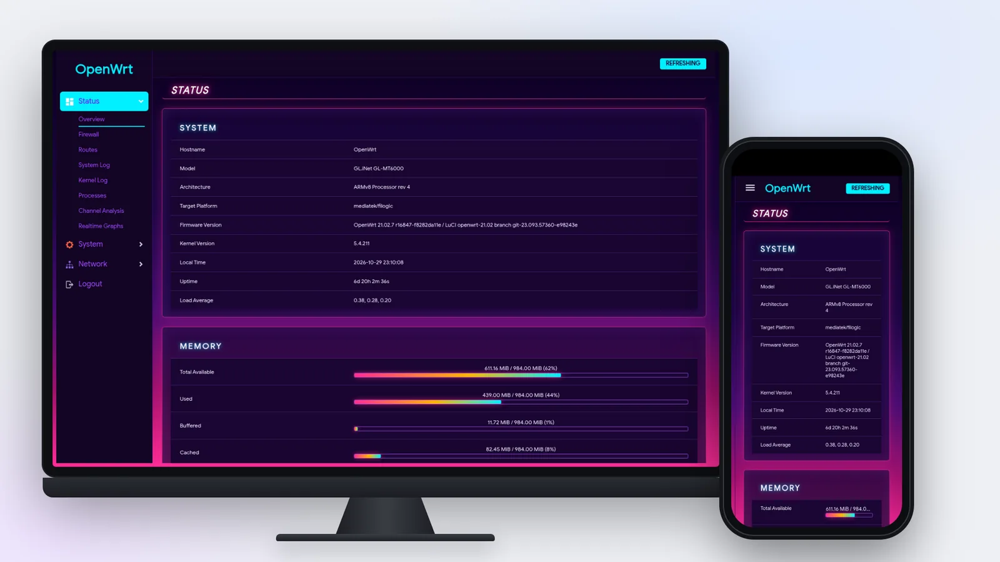</a><br><sub><a href="https://drordvash.github.io/openwrt-21.02-themes/playground/synthwave21-argon/cgi-bin/luci/">try it</a> · 139 KB</sub></td><td><a href="docs/img/synthwave21-aurora-light.webp">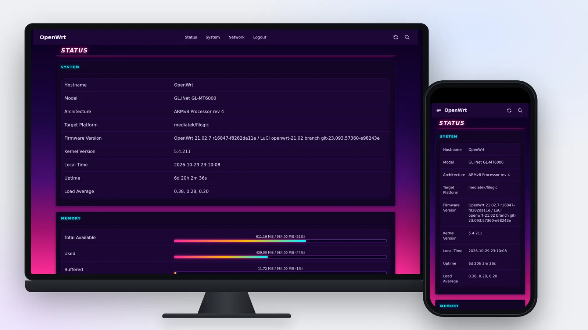</a><br><sub><a href="https://drordvash.github.io/openwrt-21.02-themes/playground/synthwave21-aurora/cgi-bin/luci/">try it</a> · 51 KB</sub></td></tr>
<tr><td><b>Teletext</b></td><td><a href="docs/img/teletext21-light.webp">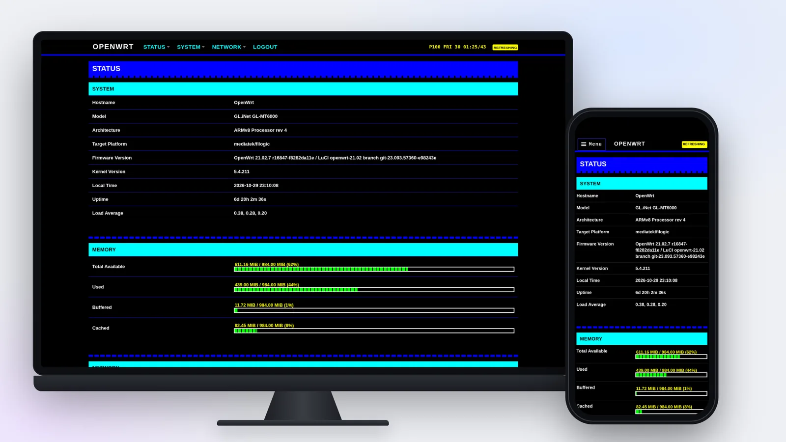</a><br><sub><a href="https://drordvash.github.io/openwrt-21.02-themes/playground/teletext21/cgi-bin/luci/">try it</a> · 25 KB</sub></td><td><a href="docs/img/teletext21-argon-light.webp">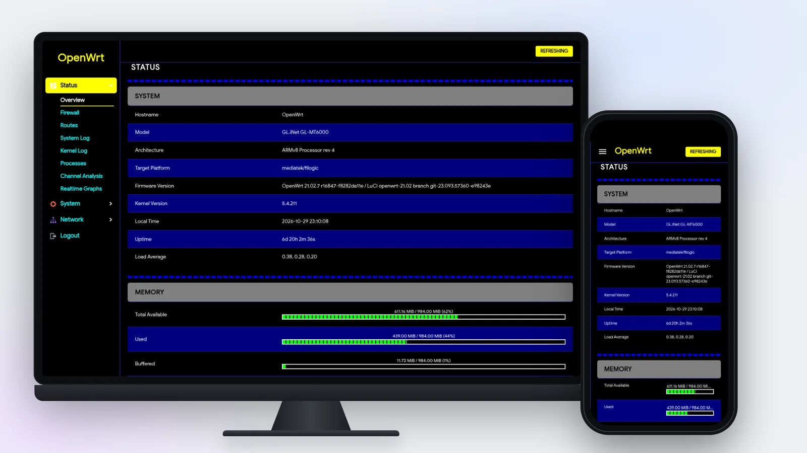</a><br><sub><a href="https://drordvash.github.io/openwrt-21.02-themes/playground/teletext21-argon/cgi-bin/luci/">try it</a> · 136 KB</sub></td><td><a href="docs/img/teletext21-aurora-light.webp">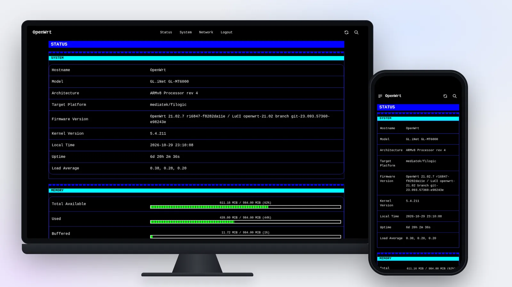</a><br><sub><a href="https://drordvash.github.io/openwrt-21.02-themes/playground/teletext21-aurora/cgi-bin/luci/">try it</a> · 48 KB</sub></td></tr>
<tr><td><b>Terminal</b></td><td><a href="docs/img/terminal21-light.webp">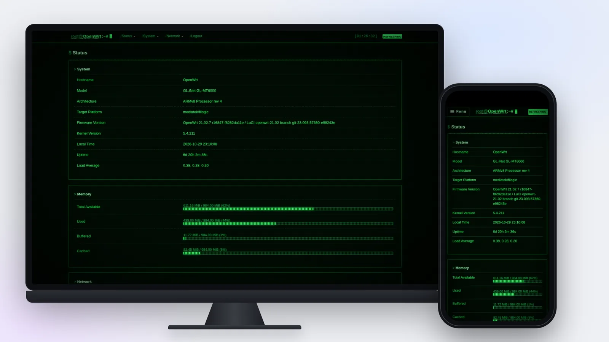</a><br><sub><a href="https://drordvash.github.io/openwrt-21.02-themes/playground/terminal21/cgi-bin/luci/">try it</a> · 26 KB</sub></td><td><a href="docs/img/terminal21-argon-light.webp">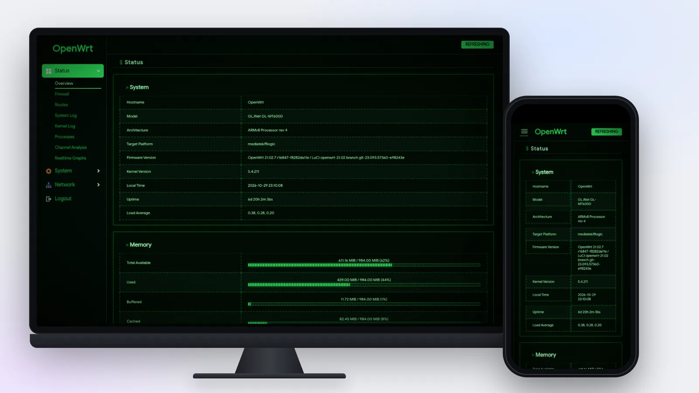</a><br><sub><a href="https://drordvash.github.io/openwrt-21.02-themes/playground/terminal21-argon/cgi-bin/luci/">try it</a> · 137 KB</sub></td><td><a href="docs/img/terminal21-aurora-light.webp"></a><br><sub><a href="https://drordvash.github.io/openwrt-21.02-themes/playground/terminal21-aurora/cgi-bin/luci/">try it</a> · 49 KB</sub></td></tr>
<tr><td><b>Topo</b></td><td><a href="docs/img/topo21-light.webp"></a><br><sub><a href="https://drordvash.github.io/openwrt-21.02-themes/playground/topo21/cgi-bin/luci/">try it</a> · 30 KB</sub></td><td><a href="docs/img/topo21-argon-light.webp"></a><br><sub><a href="https://drordvash.github.io/openwrt-21.02-themes/playground/topo21-argon/cgi-bin/luci/">try it</a> · 140 KB</sub></td><td><a href="docs/img/topo21-aurora-light.webp"></a><br><sub><a href="https://drordvash.github.io/openwrt-21.02-themes/playground/topo21-aurora/cgi-bin/luci/">try it</a> · 53 KB</sub></td></tr>
</table>

## Install

1. Download the packages you want from [Releases](https://github.com/DrorDvash/openwrt-21.02-themes/releases/latest): each `luci-theme-*.ipk` on its own,
   or all of them in one zip.
2. Copy them to the router (`-O` because the router has no SFTP):
   ```sh
   scp -O luci-theme-*.ipk root@192.168.8.1:/tmp/
   ```
3. On the router, install them:
   ```sh
   opkg install /tmp/luci-theme-*.ipk
   ```
4. Choose the theme in LuCI under **System → System → Language and Style**.

- Installing never changes your current theme. Install as many as you like and switch between
  them.
- To update, install the newer files the same way. To remove one: `opkg remove luci-theme-<name>`
  (if it was the active theme, LuCI goes back to Bootstrap).
- A package only adds its own files and needs nothing from the internet.
- Tested on a GL.iNet Flint 2 (GL-MT6000) with GL firmware 4.x and on OpenWrt 21.02.7. Other
  routers with LuCI 21.02 should work the same. On OpenWrt 23.05 or newer, use the original
  themes instead.

## Make your own port

Everything that made these packages is here: `tools/port-theme.py` ports a theme and builds its
package, and the tests check it on an offline OpenWrt 21.02 test router.
[BUILDING.md](BUILDING.md) explains the steps.

## How this was made

These ports were made with the help of an AI coding assistant. If that makes you careful about
putting them on your router, that is fair. You don't have to take my word for anything: all the
source is here, and you can try every theme in the playground before installing it.

What is in a package:

- **Mostly CSS and LuCI page templates.** They change how LuCI looks, not what it does. The
  designs are the original authors'; the work here was making them fit LuCI 21.02.
- **Some JavaScript**, the same kind the original themes ship:
  - each layout's menu script, taken from the original theme and adapted to 21.02;
  - jQuery 3.5.1, which the original Argon and Edge themes use;
  - a small fix so that "custom" entries in drop-down lists can be added with a phone keyboard;
  - UniWRT's status dashboard, which reads system, network and Wi-Fi status through the same
    read-only LuCI calls that the Status page uses;
  - Edge's light/dark switch, which remembers your choice in the browser.
- **Nothing else.** No package runs commands on the router, changes its settings or loads
  anything from the internet. The install script only adds the theme to LuCI's list, and
  removing the package takes it off again.

To check a package yourself: an `.ipk` is a tar archive (`tar -xzf file.ipk`), and its source is
in [`themes/`](themes/).

## Credits

All credit for the designs goes to their authors: these are ports, and every package keeps its
upstream licence and a NOTICE that says what was changed. Ported, tested and maintained for LuCI
21.02 by **Dror Dvash** ([@DrorDvash](https://github.com/DrorDvash)).

| Theme | Author | Upstream |
|---|---|---|
| Alpha | derisamedia | [derisamedia/luci-theme-alpha](https://github.com/derisamedia/luci-theme-alpha) |
| Aurora | eamonxg | [eamonxg/luci-theme-aurora](https://github.com/eamonxg/luci-theme-aurora) |
| Edge | kiddin9 and GaryPang | [kiddin9/luci-theme-edge](https://github.com/kiddin9/luci-theme-edge) |
| NoobWRT | nooblk-98 | [nooblk-98/luci-theme-noobwrt](https://github.com/nooblk-98/luci-theme-noobwrt) |
| UniWRT | ox1d3x3 | [ox1d3x3/uniwrt-luci](https://github.com/ox1d3x3/uniwrt-luci) |
| The 16 reskins | vistrocity | [vistrocity/openwrt-luci-themes](https://github.com/vistrocity/openwrt-luci-themes) |
| Bootstrap layout | OpenWrt LuCI | [openwrt/luci](https://github.com/openwrt/luci) |
| Argon layout | jerrykuku | [jerrykuku/luci-theme-argon](https://github.com/jerrykuku/luci-theme-argon) |
| Aurora layout | eamonxg | [eamonxg/luci-theme-aurora](https://github.com/eamonxg/luci-theme-aurora) |

The playground's idea comes from [luci-theme-footstrap](https://github.com/VizzleTF/luci-theme-footstrap)'s.

## Licence

Each package carries its upstream licence (Apache-2.0; fonts under the SIL Open Font
License 1.1) and a NOTICE. The tools in this repository are Apache-2.0.
